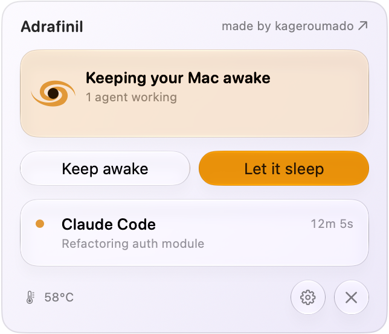

# Adrafinil

[English](README.md) · [日本語](README.ja.md)

Adrafinil は、コーディングエージェントの作業中はふたを閉じても Mac をスリープさせず、ターンが終わると抑止を解除するメニューバーアプリです。フックがエージェントごとの作業状況を追跡し、過熱保護と放置されたスリープ抑止の自動解除が、無人での長時間稼働に歯止めをかけます。

## 特長

- エージェントの作業が続く間、ふたを閉じた Mac を動かし続けます。
- 複数のエージェントを個別に追跡し、最後のスリープ抑止が終わるとスリープに戻ります。
- 過熱保護と、放置されたセッションの自動解除で、無人稼働に上限を設けます。

機能一覧

- Claude Code、Codex、Cursor、Gemini CLI、Devin、Antigravity、Aider、Hermes、OpenCode、Cline、Pi 向けのフック。
- セッション単位の acquire/release、時間制限付きのスリープ抑止、手動の **スリープさせる** 操作。
- 特権ヘルパーによる、ふたを閉じた状態でのスリープ制御。
- CLI と MCP からの利用。フックやコマンドラッパーによる独自エージェントとの連携。
- 過熱保護と、放置されたスリープ抑止の自動解除。
- 任意で、動作中のエージェントプロセスの検出、ふたを閉じたときの音による確認、ふたを開けたときの活動・温度のまとめ。
- アンインストール時のフック削除。

## カウント

明示的に選ばない限り、何も送信されません。メニューで一度だけ確認し、その選択は「設定」›「一般」に保存されます。参加を選ぶと、Adrafinil は使用した日ごとに匿名のチェックインを 1 回送信します。内容は、Adrafinil と macOS のバージョン、チップのファミリーとメモリ容量、言語と日付、直近 7 日のうち使用した日数、この Mac にふたがあるかどうか、この 1 週間にスリープを抑止したエージェントの種類の数です。どのエージェントを使っているか、何に取り組んでいるか、個人を特定できる情報は一切含まれません。オフにすると、この Mac が送信した内容をすべて削除します。[何が、どれだけの期間保存され、インストールがどのように自身を証明するか](https://github.com/kageroumado/digoxin/blob/main/REFERENCE.md)。

## 補足

- macOS 26.4 以降。特権ヘルパーの登録に管理者の承認が必要です。[macOS 15 向けバックポート](https://github.com/valentine/adrafinil)。
- Homebrew: `brew install --cask adrafinil`。エージェントのフックは「設定」からインストールします。
- [CLI、独自フック、インストール時の注意点](REFERENCE.md)（英語）。
