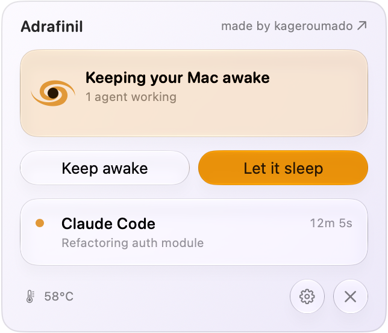

# Adrafinil

[English](README.md) · [日本語](README.ja.md)

Adrafinil keeps a Mac awake through a closed lid while a coding agent works, then releases the hold when the turn ends. Hooks track active work across agents; a thermal cutout and automatic release of abandoned holds limit unattended runs.

## Highlights

- Keep a closed-lid Mac running for the duration of agent work.
- Track overlapping agents independently; sleep resumes after the last hold ends.
- Limit unattended holds with a thermal cutout and abandoned-session cleanup.

Full feature list

- Hooks for Claude Code, Codex, Cursor, Gemini CLI, Devin, Antigravity, Aider, Hermes, OpenCode, Cline, and Pi.
- Per-session acquire/release, timed holds, and manual **Let it sleep** control.
- Closed-lid sleep control through a privileged helper.
- CLI and MCP access; custom integrations through hooks or command wrappers.
- Thermal cutout and automatic release of abandoned holds.
- Optional detection of running agent processes, lid-close audio confirmation, and a lid-open activity/temperature summary.
- Hook removal during uninstall.

## Counting

Nothing is sent unless you say so. The menu asks once; Settings › General holds the choice. If you count yourself in, Adrafinil sends one anonymous check-in on each day you use it: its own and macOS's versions, the chip family and memory size, the language and the date, how many of the last 7 days you used it, whether this Mac has a lid, and how many kinds of agent it kept awake in the last week. It never includes which agents you run, what you work on, or anything that names you. Turning it off deletes everything this Mac sent. [What is kept, for how long, and how an install proves itself](https://github.com/kageroumado/digoxin/blob/main/REFERENCE.md).

## Notes

- macOS 26.4+; administrator approval for the privileged helper. [macOS 15 backport](https://github.com/valentine/adrafinil).
- Homebrew: `brew install --cask adrafinil`; install agent hooks in Settings.
- [CLI, custom hooks, and installation quirks](REFERENCE.md).
